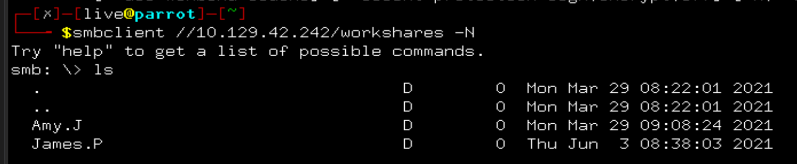
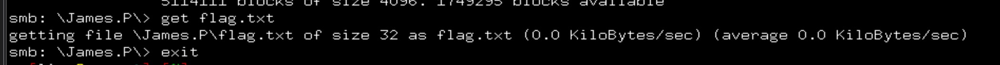
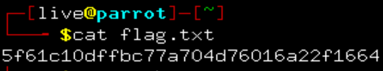

**Question 1: What does the 3-letter acronym SMB stand for?**

Answer: Server Messsage Block

**Question 2 : What port does SMB use to operate at?**

Answer: 445

**Question 3 : What is the service name for port 445 that came up in our Nmap scan?**

- Ta dùng lệnh `nmap -p 445 -sV -sC <ip>` để quét các dịch vụ dang dùng công 445

Answer : microsoft-ds

**Question 4: What is the 'flag' or 'switch' that we can use with the smbclient utility to 'list' the available SMB shares on Dancing?**

Answer : -L

Question 5 : How many shares are there on Dancing?

Ta dung lệnh `smbclient -L //<ip> -N` để quét Sharename trên ip

Answer : 4

**Question 6 : What is the name of the share we are able to access in the end with a blank password?**

Answer : Workshares

**Question 7 : What is the command we can use within the SMB shell to download the files we find?**

Answer : get

**Submit the flag located on the SMB share**

Ta truy cập dịch vụ của SMB bằng lệnh smbclient //10.129.42.242/workshares -N



Sau đó truy cập thư mục James.P để lấy file flag.txt bằng lệnh `get`



Việc còn lại là đọc file flag.txt



```text
Flag: 5f61c10dffbc77a704d76016a22f1664
```