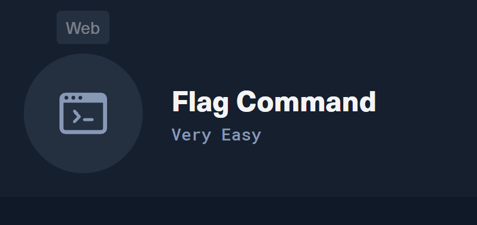
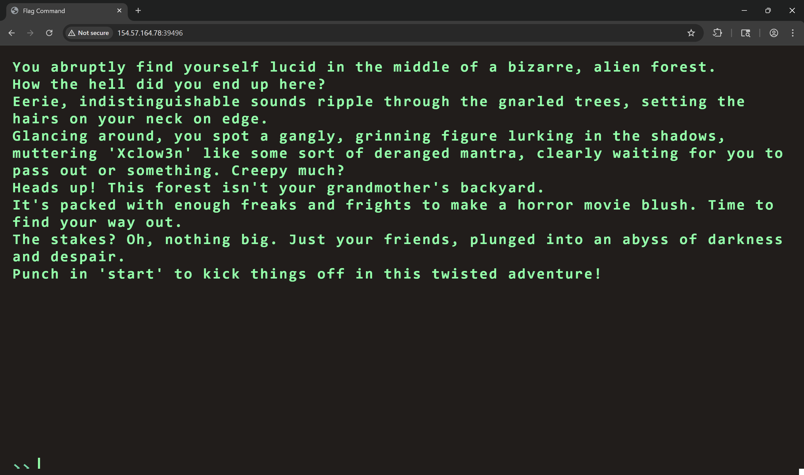
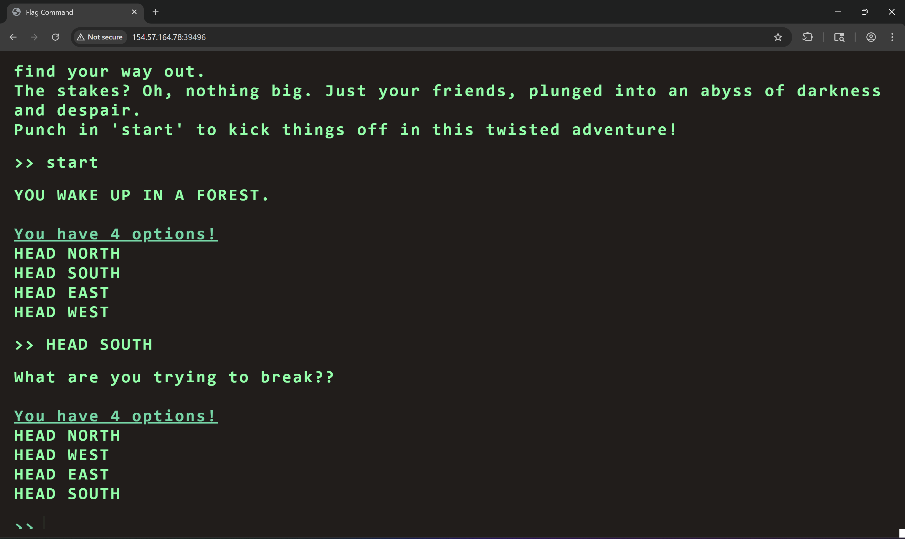
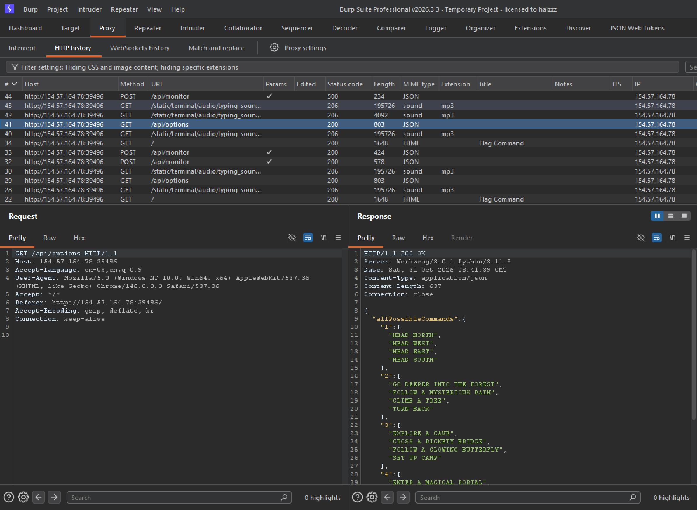
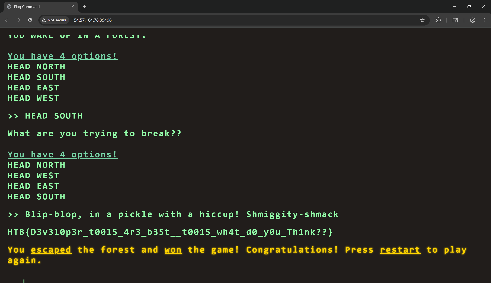

**Mô tả** : ***Hãy bắt đầu "Cuộc phiêu lưu thoát khỏi chiều không gian" nơi bạn tỉnh dậy trong một mê cung rừng bí ẩn, không hoàn toàn thuộc về thế giới này. Điều hướng qua những chú sóc biết hát, những nàng tiên tinh nghịch và những pháp sư cáu kỉnh trong một mê cung kỳ lạ có thể dẫn đến những bất ngờ đến từ thế giới khác. Liệu bạn sẽ chinh phục được mê cung đầy mê hoặc hay lạc lối trong một chiều không gian khác với những thử thách kỳ diệu? Cuộc hành trình sẽ mở ra trong cuộc phiêu lưu huyền bí này!***

Truy cập lab thì ta được một trang web 


Ta chạy lệnh `start` để xem trang web hoạt động như thế nào



Đây có vẻ như là một trò chơi lựa chọn nước đi 



Chuyển qua Burp Suite để xem request như thế nào thì ta thấy một request đến endpoint /api/options 

Trong response có một lựa chọn bí mật 

```json
       "secret": [
      "Blip-blop, in a pickle with a hiccup! Shmiggity-shmack"
    ]
```
Ta thử chọn lựa chọn bí này trong trò chói xem sao



Có vẻ như đây là thông điệp bó mật để lấy cờ

```text
HTB{D3v3l0p3r_t00l5_4r3_b35t__t0015_wh4t_d0_y0u_Th1nk??}
```
